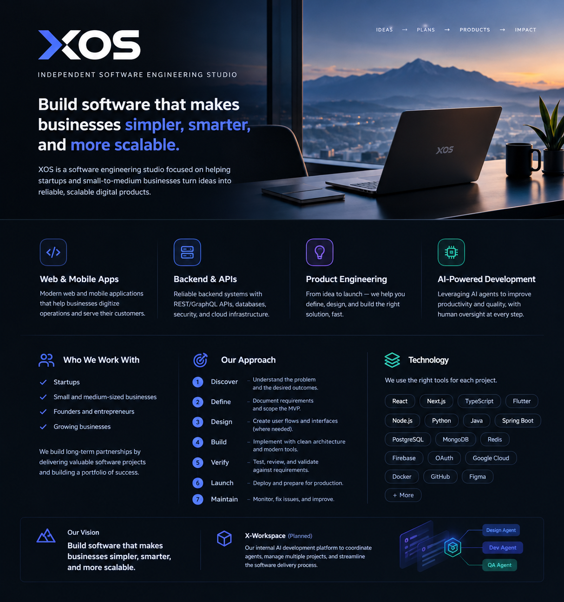

# XOS — Independent Software Engineering Studio

> Build software that makes businesses simpler, smarter, and more scalable.

XOS is an independent software engineering studio focused on helping startups and small-to-medium businesses turn business problems into reliable, scalable digital products.

From initial discovery and product planning to design, development, launch, and ongoing maintenance, XOS provides a practical engineering partner for businesses that want to build software that delivers real value.

---

<div align="center">



## Build software that makes businesses simpler, smarter, and more scalable

<strong>Independent Software Engineering Studio</strong>

[Our Services](#what-we-do) · [Our Approach](#our-approach) · [AI-Powered Development](#ai-powered-development)

</div>

---

## Table of Contents

- [About XOS](#about-xos)
- [Vision](#vision)
- [Mission](#mission)
- [What We Do](#what-we-do)
- [Who We Work With](#who-we-work-with)
- [Our Approach](#our-approach)
- [Technology](#technology)
- [AI-Powered Development](#ai-powered-development)
- [Business Model](#business-model)
- [Getting Started](#getting-started)
- [Roadmap](#roadmap)
- [Contact](#contact)

---

## About XOS

XOS is a software engineering company founded by Chenter, operating with a lean, engineering-first approach.

We believe great software starts with understanding the problem, making thoughtful technical decisions, and delivering solutions that are maintainable, secure, and ready to grow.

XOS combines software engineering expertise with AI-assisted development workflows to improve productivity while keeping product decisions, quality, and delivery under human oversight.

Our focus is simple: build useful software, deliver it reliably, and help businesses grow through technology.

## Vision

Build software that makes businesses simpler, smarter, and more scalable.

## Mission

Turn business problems into reliable, scalable software products through thoughtful engineering, practical product development, and continuous improvement.

## What We Do

### Web Application Development

Build modern web applications that help businesses digitize operations, serve customers, and improve productivity.

Examples include:

- Business management platforms
- Admin dashboards and internal tools
- SaaS products
- Customer portals and marketplaces
- E-commerce and business workflow systems

### Mobile Application Development

Develop mobile experiences that connect businesses with their customers and teams.

Examples include:

- iOS and Android applications
- Cross-platform mobile applications
- Customer-facing applications
- Business and field-operation applications
- Point-of-sale and operational tools

### Backend and API Engineering

Design and implement dependable backend systems that support business applications.

Examples include:

- REST and GraphQL APIs
- Authentication and authorization
- Database design and data management
- Third-party integrations
- Real-time communication
- Cloud deployment and infrastructure

### Product Engineering and Technical Consulting

Help businesses move from an initial idea to a well-defined, implementable software product.

Examples include:

- Requirements discovery and documentation
- MVP scoping and prioritization
- System architecture and technical planning
- Codebase reviews and technical improvements
- Release planning and ongoing maintenance

---

## Who We Work With

XOS primarily targets:

- **Startups** — turn ideas into testable, launchable products.
- **Small and medium-sized businesses** — streamline operations with custom software.
- **Founders and entrepreneurs** — find an engineering partner to build and validate digital products.
- **Growing businesses** — improve existing systems, integrations, and technical infrastructure.

Our initial business objective is to establish strong client relationships by delivering valuable software projects and building a portfolio of successful work.

---

## Our Approach

XOS follows a practical, outcome-focused software delivery process.

1. **Discover** — understand the business problem, users, constraints, and desired outcomes.
2. **Define** — document requirements, scope the MVP, and establish acceptance criteria.
3. **Design** — create user flows, wireframes, and interface designs where needed.
4. **Build** — implement the solution using maintainable architecture and appropriate technologies.
5. **Verify** — test functionality, review code, and validate the solution against requirements.
6. **Launch** — prepare releases, deployment, and production configuration.
7. **Maintain** — monitor, fix issues, and improve the product as business needs evolve.

Each engagement is tailored to the project's scope, timeline, budget, and technical requirements.

## Technology

XOS selects technologies based on the problem being solved, the project's constraints, and long-term maintainability.

Our engineering experience and preferred tools include:

| Area | Technologies |
| --- | --- |
| Web frontend | React, Next.js, TypeScript |
| Mobile | Flutter, Dart |
| Backend | Node.js, Express, TypeScript, Python, Java, Spring Boot |
| APIs | REST, GraphQL |
| Databases | PostgreSQL, MongoDB, Redis |
| Authentication | Firebase Authentication, OAuth 2.0, OpenID Connect |
| Cloud and deployment | Google Cloud, DigitalOcean, Docker, CI/CD |
| Engineering workflow | Git, GitHub, automated testing |
| Product and design | Figma, project documentation, task tracking |
| AI-assisted development | AI coding assistants and agent-based workflows |

This is a technology toolkit, not a requirement that every project use every technology. Final selections depend on project needs.

---

## AI-Powered Development

XOS aims to use AI agents to improve the efficiency of software planning and delivery while preserving human control over important decisions.

The longer-term vision includes an internal platform called **X-Workspace**, designed to coordinate AI-assisted software development across multiple projects.

### Planned agent workflow

```text
Founder / Product Owner
          |
          v
   Project Manager
          |
          v
   Requirements & Planning
          |
          v
     Design Agent
          |
          v
   Founder Approval
          |
          v
   Development Agent
          |
          v
       QA Agent
          |
          v
  Review & Release Approval
          |
          v
   Deployment & Maintenance
```

The workflow is intended to support human approval at important checkpoints rather than allowing agents to make every product or release decision independently.

### Planned capabilities

- Product discovery and requirements definition
- Task breakdown, prioritization, and project planning
- AI-assisted UI/UX design workflows using Figma
- AI-assisted implementation in GitHub repositories
- Automated testing and quality checks
- Pull request creation and code review support
- Project progress tracking and reporting
- Coordination of multiple projects and agents
- Release planning and post-release maintenance workflows

### Development principles

- **Human-in-the-loop:** important decisions and approvals remain under human control.
- **Permission-based execution:** agents receive only the access required for their assigned tasks.
- **Traceability:** tasks, changes, decisions, and outcomes should be reviewable.
- **Quality first:** generated code must be validated through appropriate reviews and tests.
- **Incremental delivery:** implement and verify capabilities in stages.
- **Project isolation:** concurrent projects should have separate workspaces, configurations, and execution contexts.

These capabilities describe the intended direction of X-Workspace. They should be marked as implemented only after they are built and verified.

---

## Business Model

XOS follows a service-oriented model that can evolve as the business grows.

### 1. Project Development

Deliver custom web applications, mobile applications, backend services, and MVPs based on an agreed scope.

### 2. Product Launch

Help clients prepare their software for release, including deployment, configuration, testing, and release support.

### 3. Ongoing Maintenance

Provide continuing technical support, bug fixes, performance improvements, and feature development.

This model creates opportunities to establish long-term client relationships rather than treating every project as a one-time delivery.

---

## Getting Started

XOS is the studio and business identity. Individual products and internal tools can have their own repositories, documentation, and setup instructions.

To start a new software project:

1. Define the business problem and target users.
2. Document the product requirements and MVP scope.
3. Select the technology stack based on the project's needs.
4. Create the repository and establish the development workflow.
5. Implement, test, review, and release the product incrementally.
6. Document deployment, maintenance, and future improvements.

### Internal development platform

For work on X-Workspace, maintain a dedicated project repository containing its architecture, implementation plan, agent definitions, permissions, integrations, and development instructions.

Project-specific installation commands and environment variables should live in that repository's README rather than being assumed to apply to all XOS projects.

---

## Roadmap

The roadmap below describes business and platform priorities. It is not a statement that these milestones have already been completed.

### Phase 1 — Establish the Studio

- [ ] Finalize XOS positioning and brand identity
- [ ] Define service packages and project engagement process
- [ ] Establish a professional online presence
- [ ] Build an initial portfolio of software projects
- [ ] Acquire the first paying client
- [ ] Standardize proposals, requirements, and delivery documentation

### Phase 2 — Standardize Engineering

- [ ] Create reusable project templates
- [ ] Standardize repository structure and development conventions
- [ ] Establish repeatable testing and code review practices
- [ ] Document deployment and maintenance procedures
- [ ] Improve project estimation and delivery tracking

### Phase 3 — Build X-Workspace MVP

- [ ] Initialize projects from user-provided GitHub repositories
- [ ] Create and manage project tasks
- [ ] Implement a local TypeScript and Node.js execution engine
- [ ] Define agent roles, tools, and execution permissions
- [ ] Integrate Figma into the design workflow
- [ ] Support human review and approval checkpoints
- [ ] Execute development workflows across multiple projects
- [ ] Track agent activity, task status, and project progress

### Phase 4 — Expand Automation

- [ ] Introduce deeper GitHub and pull request integrations
- [ ] Add automated quality checks and testing workflows
- [ ] Integrate a task management platform when needed
- [ ] Improve agent coordination and failure recovery
- [ ] Add release and maintenance workflows
- [ ] Measure delivery quality and operational efficiency

Milestones should be updated as work is completed, and features should not be presented as available until they have been implemented and verified.

---

## Contact

For business inquiries, project proposals, or collaboration opportunities:

- **Company:** XOS
- **Type:** Independent Software Engineering Studio
- **Services:** Web Development, Mobile Development, Backend Engineering, Product Engineering

Add the official website, business email, GitHub organization, and other public contact links here when they are established.

---

## Guiding Principle

> Build with purpose. Engineer with precision. Deliver with confidence.

XOS exists to turn meaningful business problems into dependable software — one project at a time.
